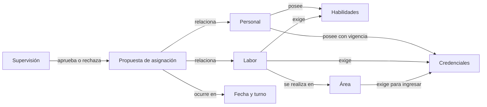
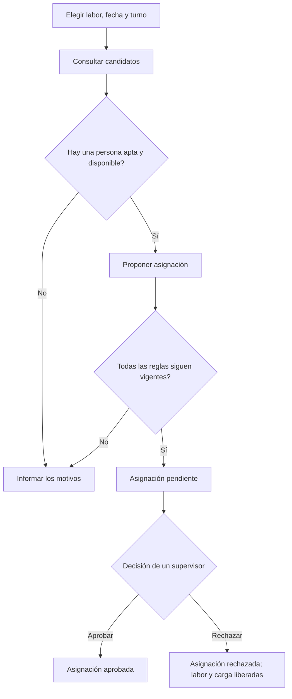

# Trabajo Práctico: Sistema de Gestión de Capacidades y Asignación de Personal

## Situación Hipotética

*Innovación Industrial Tech (IIT)* necesita organizar las labores técnicas de sus plantas. En la actualidad, los supervisores coordinan al personal mediante planillas aisladas. Como consecuencia, se proponen asignaciones a personas sin las credenciales requeridas, se supera la capacidad segura de algunas áreas y resulta difícil conocer la carga diaria y semanal real de cada integrante.

La empresa solicita un prototipo que permita registrar las condiciones de trabajo y proponer asignaciones válidas. El sistema no decide automáticamente quién debe realizar cada labor: informa qué personas son candidatas, valida una propuesta y deja su aprobación a un supervisor.

### Objetivo del sistema

El prototipo deberá permitir:

- registrar personal, habilidades y credenciales;
- describir áreas, turnos y labores;
- consultar candidatos para una labor en una fecha y un turno;
- proponer, aprobar o rechazar asignaciones;
- impedir asignaciones que violen requisitos técnicos, disponibilidad, capacidad del área o carga horaria diaria y semanal.

### Alcance y vocabulario del dominio

Los siguientes conceptos delimitan el problema, pero no prescriben una clase por cada sustantivo. Parte del trabajo consiste en decidir cómo traducir este vocabulario a objetos y cómo distribuir sus responsabilidades.

| Concepto | Representa | Es responsable de | No es responsable de |
| --- | --- | --- | --- |
| Personal | Una persona que puede realizar labores | Su identidad, habilidades, credenciales y máximos diario y semanal | La capacidad de un área o los requisitos de una labor |
| Supervisor | Un integrante del personal con autoridad adicional y áreas bajo su responsabilidad | Aprobar o rechazar asignaciones y recibir notificaciones sobre sus áreas | Modificar las reglas para conseguir una aprobación |
| Credencial | Una acreditación obtenida por una persona | Informar si está vigente en una fecha | Decidir si una persona es apta para una labor completa |
| Área | Un espacio físico de trabajo a cargo de un supervisor | Credenciales de acceso, capacidad máxima por turno y supervisor responsable | El horario de un turno o la duración de una labor |
| Turno | Una franja horaria reutilizable, por ejemplo, Mañana de 06:00 a 14:00 | Hora de inicio, hora de fin y duración | La fecha concreta y las personas asignadas |
| Labor | Un trabajo pendiente que debe realizarse una sola vez | Duración, área, habilidades y credenciales requeridas | Elegir una persona o reservar capacidad |
| Asignación | La propuesta de que una persona realice una labor en una fecha y un turno | Relacionar persona, labor, fecha y turno; mantener su estado | Redefinir datos de personal, área, turno o labor |

Una **fecha y un turno** forman una ocurrencia concreta. Por ejemplo, el turno Mañana es una definición reutilizable; “Mañana del 18/08/2026” es la ocurrencia sobre la que se controla disponibilidad y capacidad.

Este mapa solo expresa información del negocio. No determina clases, herencia, navegabilidad, colecciones ni el objeto que coordina una asignación: esas decisiones forman parte de la entrega.

### Flujo principal

La consulta de candidatos no modifica el sistema. Las validaciones deben repetirse al proponer y al aprobar, porque entre ambos momentos pudo aprobarse otra asignación o vencer una credencial.

### Fuera de alcance

No se requiere desarrollar una interfaz gráfica, persistencia en base de datos, autenticación, gestión de vacaciones, división de una labor entre varias personas ni un algoritmo que optimice automáticamente el reparto. Tampoco se contemplan turnos que atraviesen la medianoche.

## Requerimientos Técnicos Obligatorios

- Implementar la solución con Programación Orientada a Objetos y separar el punto de entrada de la lógica del dominio.
- Identificar y justificar una jerarquía en la que herencia represente una verdadera relación de especialización. La facultad de supervisión es una posibilidad del dominio, no una implementación impuesta.
- Aplicar polimorfismo en al menos un comportamiento con alternativas justificadas; por ejemplo, una política de selección u ordenamiento de candidatos. No alcanza con heredar sin sustituir comportamiento.
- Definir excepciones propias para los incumplimientos del negocio. No se aceptan `Exception` genéricas ni mensajes impresos como único manejo del error.
- Mantener encapsulado el estado: una asignación no puede aprobarse cambiando directamente un atributo.
- Escribir pruebas unitarias con `pytest` para las reglas y transiciones críticas.
- Utilizar `date`, `time` o `datetime` de la biblioteca estándar para fechas y horarios.

## Reglas de Negocio

1. **Datos válidos:** Los identificadores de personal y labores son únicos. La duración de una labor y los máximos diario y semanal de una persona son positivos. Cada persona configura sus propios máximos, pero el diario no puede superar las 8 horas y el semanal no puede superar las 40 horas. La capacidad de un área es un entero positivo. Un turno termina después de comenzar.
2. **Vigencia inclusiva:** Una credencial está vigente cuando `fecha_desde <= fecha_consultada <= fecha_hasta`. Dos credenciales con el mismo nombre no otorgan beneficios adicionales.
3. **Aptitud técnica:** Una persona es apta cuando contiene todas las habilidades requeridas por la labor y todas las credenciales exigidas tanto por la labor como por su área. Las credenciales deben estar vigentes en la fecha de la asignación.
4. **Área determinada por la labor:** Cada labor pertenece a exactamente un área. La asignación no recibe otra área, con lo cual no puede contradecir a la labor.
5. **Labor contenida en el turno:** La duración estimada de la labor no puede superar la duración del turno elegido. En este prototipo una labor no se divide entre turnos.
6. **Disponibilidad personal:** Una persona no puede tener más de una asignación pendiente o aprobada en la misma fecha y turno, aunque las labores pertenezcan a áreas diferentes.
7. **Capacidad del área:** Para una fecha y un turno, la cantidad de asignaciones aprobadas en un área no puede superar su capacidad. Las asignaciones pendientes o rechazadas no ocupan lugar. Por lo tanto, varias propuestas pendientes pueden competir por el último cupo disponible; al aprobar una de ellas, las demás deberán volver a validar la capacidad.
8. **Carga diaria y semanal:** La suma de las duraciones de las asignaciones pendientes o aprobadas de una persona no puede superar su máximo diario en la fecha de la nueva asignación ni su máximo semanal dentro de la semana calendario correspondiente. La semana comienza el lunes. Si una propuesta supera alguno de estos límites, el sistema rechaza la operación sin crear la asignación e informa el motivo al supervisor responsable del área de la labor.
9. **Unicidad de la labor:** Una labor puede tener, como máximo, una asignación pendiente o aprobada. Si una propuesta es rechazada, la labor vuelve a quedar disponible para otra propuesta.
10. **Transiciones permitidas:** Una asignación nace `PENDIENTE`. Solo puede pasar de `PENDIENTE` a `APROBADA` o `RECHAZADA`; ambos estados son finales.
11. **Autoridad de supervisión:** Solo un supervisor puede aprobar o rechazar. Antes de aprobar, el sistema vuelve a evaluar aptitud, disponibilidad, capacidad y carga diaria y semanal. Si alguna condición dejó de cumplirse, conserva el estado pendiente e informa el motivo al supervisor que intentó aprobarla.
12. **Consulta de candidatos:** Para una labor, fecha y turno, el sistema devuelve únicamente personal que satisfaga las reglas 3, 5, 6 y 8, siempre que la cantidad de asignaciones aprobadas todavía no haya alcanzado la capacidad del área. La consulta no crea asignaciones ni altera horas o cupos.

### Ejemplo de aceptación

El área “Sala Eléctrica” admite dos personas por turno y exige la credencial “Seguridad Eléctrica”. La labor `L-17` dura tres horas, requiere la habilidad “diagnóstico” y se realiza en esa área. Ana tiene la habilidad y una credencial vigente, trabaja como máximo ocho horas semanales y ya posee una asignación de seis horas esa semana. Bruno cumple los requisitos técnicos, pero ya tiene otra asignación en el turno solicitado.

Al consultar candidatos para `L-17`, Ana queda excluida porque alcanzaría nueve horas y Bruno queda excluido por falta de disponibilidad. El resultado debe estar vacío e incluir motivos que permitan distinguir ambos casos. Si se rechaza la asignación previa de Bruno, una nueva consulta debe incluirlo sin modificar todavía su carga ni la capacidad del área.

### Pruebas mínimas esperadas

- vigencia de una credencial en ambas fechas límite y fuera de ellas;
- falta de una habilidad, credencial de labor o credencial de área;
- capacidad del área ocupada solo por asignaciones aprobadas y conflicto entre propuestas pendientes al aprobar;
- doble asignación de una persona y doble asignación de una labor;
- carga diaria y semanal justo en cada límite y por encima de ellos;
- rechazo de una propuesta que exceda la carga configurada y notificación al supervisor responsable del área;
- aprobación por personal común y transición desde un estado final;
- liberación de la labor y la carga luego de rechazar una asignación pendiente, sin alterar la capacidad ocupada;
- consulta de candidatos sin efectos secundarios.

### Decisiones de diseño que deberán resolver

El enunciado define qué debe ocurrir, pero deliberadamente no responde estas preguntas:

- ¿Qué objeto conoce el conjunto de asignaciones y coordina una nueva propuesta?
- ¿La carga diaria y semanal se calcula a partir de las asignaciones o se mantiene como estado? ¿Cómo se evita que ambas fuentes se contradigan?
- ¿Cómo se representan habilidades y credenciales para comparar requisitos sin duplicar lógica?
- ¿Cómo se comunican varios motivos de inaptitud sin acoplar el dominio a `print` o a una interfaz futura?
- ¿Dónde se ubican las transiciones de estado para impedir cambios inválidos?
- ¿Qué comportamiento conviene hacer polimórfico para incorporar nuevas políticas de selección sin modificar el núcleo?

No existe una única respuesta correcta. Se evaluarán la coherencia del modelo, el reparto de responsabilidades, el bajo acoplamiento y la capacidad de defender las decisiones con pruebas.

### Evolución durante el semestre

El trabajo se desarrollará de manera incremental. Cada etapa debe conservar las pruebas de las anteriores y puede exigir refactorizaciones del diseño.

1. **Modelo inicial:** vocabulario, diagrama propio, invariantes y primeros objetos sin automatizar asignaciones.
2. **Núcleo de asignación:** aptitud, disponibilidad, capacidad, carga diaria y semanal, notificaciones y excepciones.
3. **Ciclo de aprobación:** estados, permisos, liberación de recursos y consultas sin efectos secundarios.
4. **Variación de comportamiento:** al menos dos políticas intercambiables para ordenar candidatos, por ejemplo menor carga semanal y mayor cantidad de credenciales vigentes. El ordenamiento no elige ni asigna automáticamente.
5. **Cambio controlado:** la cátedra seleccionará una extensión —por ejemplo cancelación de una asignación aprobada, ausencias o capacidades diferentes según el turno— para evaluar qué tan bien evoluciona el modelo.

En cada etapa deberán entregar pruebas nuevas y una breve actualización del diagrama y de las decisiones de diseño afectadas.

## Notas

- Se prohíbe el uso de la librería pandas; el objetivo es evaluar el manejo de estructuras nativas (listas, diccionarios) y la lógica de algoritmos manuales.
- Antes de codificar, presenten un diagrama que muestre las responsabilidades y relaciones entre los conceptos del dominio. Puede ser un diagrama de clases o una alternativa equivalente debidamente justificada.
- Cada implementación debe estar sustentada: deberán explicar las decisiones tomadas y demostrar las reglas mediante pruebas automatizadas.
- Se permite usar la biblioteca estándar de Python. No se permite incorporar una librería que resuelva automáticamente la asignación.
